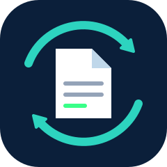

<p align="center"></p>

# Fliq

Share any file to **Fliq** and convert or rename it in one tap. No home screen, no clutter.
The result is saved **in the same folder as the original**.

Built to stay small and light: plain Android views (no Compose, no AndroidX), one background thread,
and every file or PDF page is processed one at a time and freed straight away.

## What it does

| You share | Fliq offers |
|---|---|
| JPG, PNG, WebP, BMP, GIF, HEIC | convert to JPG / PNG / WebP / BMP / PDF (several images can be merged into one PDF) |
| SVG | PNG / JPG / WebP / BMP / PDF |
| PDF | pages to PNG / JPG / WebP |
| PDF | also: PDF to Word (needs the converter server) |
| Word, Excel, PowerPoint (doc/docx/odt/rtf, xls/xlsx/ods/csv, ppt/pptx/odp) | convert to PDF (needs the converter server) |
| anything | rename: Clean, snake_case, Date + name, or your own name |

Office conversions can't run offline in a few hundred KB, so the app uploads the file to your own small
LibreOffice server ([`server/`](server/README.md), free to host) and saves the result back next to the original.
Everything else stays on the phone. The app only asks for the Internet permission for this.

Converting and renaming both save a **new copy** next to the original; the original is never touched.

## Same-folder saving

Android only lets an app create files in some folders. Fliq finds the original folder from the shared file and writes there when Android allows it:

- `Download/…`: any file type
- `Pictures/…` and `DCIM/…`: image results
- `Documents/…`: non-media results (e.g. PDF)

If the original folder can't be found or isn't allowed (for example a PDF made from a photo in `Pictures`), Fliq saves to `Download/Fliq` and tells you.

## Roadmap

- Release signing + GitHub releases
- Cast receiver (Chrome + DLNA) and the GameCube emulator are separate apps

## Build

GitHub Actions builds an APK on every push (see the **Actions** tab, artifact `Fliq-debug-apk`).

Locally, with the Android SDK installed:

```
./gradlew :app:assembleDebug
```

Min Android 10 (API 29).
